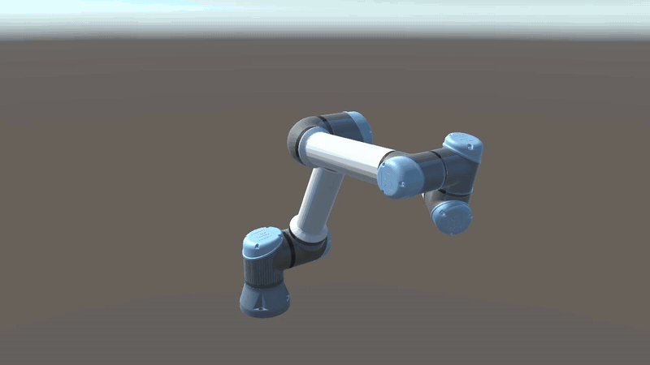

# UR5e World Model

A Universal Robots UR5e arm simulated with MuJoCo inside Unity, with a learned world model, a controller trained inside that model's imagination, and inverse kinematics that tracks a target you can drag around the arm.

**Course:** CS 6983 · Physical AI, World Models, and Games · Fall 2026, Coding Assignment 3  
**Author:** Aarya Rajgor

## Demo

[](Recordings/ur5e_ik_demo.mp4)

Step 4 in action: IK turns the `TrackingTarget` sphere's position into joint goals, and the learned controller drives the arm to follow it as it loops in front of the arm. The see-through ghost arm is the world model's prediction, and the yellow line is its imagined path for the tool. Click the GIF for the full 28-second video ([`Recordings/ur5e_ik_demo.mp4`](Recordings/ur5e_ik_demo.mp4)).

## Results (from the Unity rollout)

| | Result |
|---|---|
| Rollout | 70,000 steps at a 0.01 s fixed timestep, random joint goals every 1.5 s |
| World model, one-step joint RMSE | 0.0090 rad |
| World model, open-loop 10 / 50 / 100-step RMSE | 0.058 / 0.109 / 0.110 rad |
| Controller, imagined return (CMA-ES, held-out goals) | −3.257 |

The full write-up is in [`Assets/CA3/REPORT.md`](Assets/CA3/REPORT.md), and the reflection is in [`Assets/CA3/REFLECTION.md`](Assets/CA3/REFLECTION.md).

## How it works

| Step | Code | What it does |
|---|---|---|
| Arm interface | `ArmAgent.cs`, `ArmJointController.cs` | Reads the joint state `[q, qd]`, writes one position target per actuator, and samples random goals around the home pose. |
| Data | `RolloutRecorder.cs` | Logs `(q, qd, q*, q', qd')` every physics step to `Assets/CA3/Data/rollout.csv`. |
| World model | `train.py`, `WorldModelDriver.cs` | An MLP predicts the change in state from `[q, qd, q*]`. It is exported to ONNX and run in Unity's Inference Engine to drive the ghost arm and forecast line. |
| Controller | `train_controller.py`, `WorldModelController.cs` | A linear policy `a = goal + W·[q − goal, qd] + b`, optimized with CMA-ES entirely inside the world model, then run live in Unity. |
| IK | `IkGoalProvider.cs` | Damped least squares on the tool site, with a null-space pull toward the home pose. It passes joint goals to the controller. |

## Requirements

- Unity **6000.3.24f1** (built-in render pipeline).
- MuJoCo **3.17.0**:
  - The Unity plugin is in `External/mujoco-3.17.0/unity`, referenced from `Packages/manifest.json`.
  - The macOS native library (`mujoco.dylib`) is already in that folder. On Windows or Linux, copy your platform's library there instead, following the plugin's instructions.
- Python 3.12 with the packages in `requirements.txt`.

## Running

1. Open the project in Unity and open `Assets/CA3/CA3.unity`. The **CA3** menu sets up each step:
   - **Set Up Rollout Recording**: press Play to record `rollout.csv`.
   - **Set Up Learned Controller + Ghost (Step 3)**: the controller follows random goals.
   - **Set Up IK Tracking (Step 4)**: press Play and drag `TrackingTarget` in the Scene view.
   - **Record IK Demo Video**: recreates the demo recording.
2. Train the world model and controller:

```bash
python3 -m venv .venv && .venv/bin/pip install -r requirements.txt
```

```bash
cd Assets/CA3 && ../../.venv/bin/python train.py && ../../.venv/bin/python train_controller.py
```

[`CA3_SETUP.md`](CA3_SETUP.md) has the detailed setup guide, including the UR5e values taken from the MJCF and notes on Unity problems hit during setup.

## Layout

```
Assets/CA3/         assignment scripts, training scripts, scene, ghost prefab, REPORT.md, REFLECTION.md
Assets/CA3/Data/    rollout.csv, dynamics.onnx, norm.json, controller.json
Assets/Editor/      CA3 menu (scene setup and demo recording)
Assets/Local/       meshes and materials created by the MuJoCo importer
External/           MuJoCo 3.17.0 Unity plugin
MJCF/               UR5e model from MuJoCo Menagerie
Recordings/         demo video
```

## Credits

- UR5e model: [MuJoCo Menagerie](https://github.com/google-deepmind/mujoco_menagerie/tree/main/universal_robots_ur5e). Its license is in `MJCF/universal_robots_ur5e/LICENSE`.
- MuJoCo and its Unity plugin: Google DeepMind, Apache-2.0.
- Assignment skeleton (`CA3_Scripts`): CS 6983 course staff.
